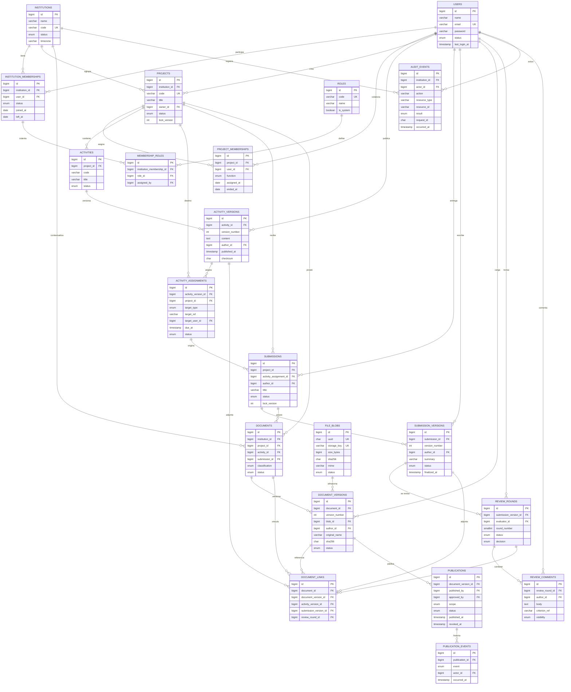

# ERD — ARIS 2.0

> Diagrama lógico del núcleo. Las **migraciones Laravel** son la fuente de verdad; este
> diagrama se actualiza con ellas. Nombres en minúscula en la base; aquí en mayúscula por
> convención de Mermaid.
>
> Alcance: 21 entidades propias. Las tablas del framework (`password_reset_tokens`,
> `sessions`, `cache`, `cache_locks`, `jobs`, `job_batches`, `failed_jobs`) **no** se
> duplican ni se documentan aquí.

## 1. Diagrama

## 2. Cardinalidades clave

| Relación | Cardinalidad | Nota |
|---|---|---|
| Institución ↔ miembros | 1 : N | `UNIQUE (institution_id, user_id)` |
| Miembro ↔ roles | N : M vía `membership_roles` | Varios roles por persona |
| Proyecto ↔ miembros | 1 : N | Responsabilidad con vigencia (`ended_at`) |
| Actividad ↔ versiones | 1 : N | `UNIQUE (activity_id, version_number)` |
| Asignación ↔ versión de guía | N : 1 | La asignación fija la versión exacta |
| Entrega ↔ versiones | 1 : N | `UNIQUE (submission_id, version_number)` |
| Documento ↔ versiones | 1 : N | `UNIQUE (document_id, version_number)` |
| Versión de documento ↔ blob | N : 1 | Un blob puede reutilizarse (mismo checksum) |
| Versión de entrega ↔ revisiones | 1 : N | Cada ronda apunta a una versión concreta |
| Revisión ↔ comentarios | 1 : N | Comentarios append-only |
| Versión de documento ↔ publicación | 1 : N | Solo una activa por documento (regla de aplicación) |
| Publicación ↔ eventos | 1 : N | Historial append-only |

## 3. Restricciones que el diagrama no muestra

- `CHECK`: exactamente uno de (`project_id`, `activity_id`, `submission_id`) en `documents`.
- `CHECK`: exactamente uno de (`activity_version_id`, `submission_version_id`,
  `review_round_id`) en `document_links`.
- `CHECK`: `version_number >= 1` en todas las tablas versionadas.
- `CHECK`: `size_bytes > 0`, `sha256` con 64 caracteres hexadecimales.
- `UNIQUE (activity_version_id, target_type, target_ref)` en asignaciones, para que un mismo
  destinatario no reciba dos veces la misma versión de guía.
- `UNIQUE (submission_version_id, evaluator_id, round_number)` en revisiones.
- Índices: `(institution_id, status)`, `(project_id, status)`, `(project_id, created_at)`,
  `(submission_id, version_number)`, `(document_id, version_number)`,
  `(institution_id, occurred_at)` para auditoría.

## 4. Verificación del diagrama

El bloque Mermaid debe renderizar sin errores en un renderizador compatible (GitHub, VS Code,
`mmdc`). **Estado:** pendiente de renderizado automatizado en F1; no se declara verificado
hasta ejecutarlo con la herramienta disponible. La equivalencia con las migraciones se
comprobará tabla por tabla al generarlas.
